# FESTIVAL GENERUS — PART 1: FOUNDATION & SYSTEM ARCHITECTURE

## 1. Laporan Audit Repository & Arsitektur Aplikasi

### 1.1 Tech Stack & Framework
- **Framework Utama**: React 19 (`^19.2.0`) + Vite 7 (`^7.3.1`) + TanStack Start (`@tanstack/react-start`) & TanStack Router (`@tanstack/react-router`).
- **Styling & UI**: Tailwind CSS v4 (`@tailwindcss/vite`), Radix UI primitives (`src/components/ui/*`), Lucide React icons, Recharts, dan Sonner toast notifications.
- **Database & Backend**: Supabase PostgreSQL (`@supabase/supabase-js`) dengan dukungan Server Functions / API Routes (`src/routes/api/*`) dan hybrid local/remote state synchronization (`monev_state_store` pattern).
- **Autentikasi & Hierarki Organisasi**:
  - Aplikasi utama menggunakan sistem autentikasi terintegrasi (`src/hooks/use-auth.ts` & `src/lib/mockData.ts` `verifyCredentials`/`getUserDetails`).
  - Hierarki organisasi 3 tingkat telah terdefinisi secara baku pada **Daerah Magetan Timur**:
    1. **Daerah**: `Daerah Magetan Timur`
    2. **Desa (4 Wilayah Induk)**:
       - `Desa Selatan` (7 Kelompok: Karas, Patihan, Malang, Pandeyan, Soco, Setren, Bendo)
       - `Desa Tengah` (6 Kelompok: Candi, Gombel, Barat, Ngumpul, Blaran 2, Sumberejo)
       - `Desa Utara` (10 Kelompok: Blaran 1, Tawang, Jeruk, Singgahan 1, Singgahan 2, Karasan, Klampisan, Dinden, Wruk/Waruk, Guyung)
       - `Desa Timur` (7 Kelompok: Panggangung/Panggung, Klagen Serut, Teseh, Dingin, Klayapan 1, Klayapan 2, Pencol)
    3. **Kelompok**: Total **30 Kelompok** aktif.

### 1.2 Tabel Database & Data yang Dapat Digunakan Kembali
| Sumber Data Eksisting | Fungsi Integrasi pada Festival Generus |
| :--- | :--- |
| `generus` (`getGenerus()`) | Sumber master data santri/Caberawit untuk pendaftaran peserta (`fg_participants.generus_id`) beserta snapshot identitas historis (`snapshot_full_name`, `snapshot_nis`, `snapshot_birth_date`, `snapshot_age`, `snapshot_group_name`, `snapshot_village_name`, `snapshot_region_name`). |
| `tpq_kelompok` (`getKelompok()`) | Sumber master 30 Kelompok & 4 Desa untuk pembentukan kontingen (`fg_contingents`). |
| `mubaligh_setempat` & `mubaligh_tugasan` | Sumber data dewan juri, koordinator kontingen, dan pendamping kelompok. |
| `pengurus_internal` | Referensi kepanitiaan daerah/desa/kelompok (Ketua Panitia, Sekretaris, Dewan Juri). |
| `profiles` & `user_roles` | Integrasi profil autentikasi Supabase dan role pengguna. |

### 1.3 Komponen UI yang Dapat Digunakan Kembali
- `Card`, `CardHeader`, `CardTitle`, `CardDescription`, `CardContent` (`src/components/ui/card.tsx`)
- `Badge` (`src/components/ui/badge.tsx`)
- `Button` (`src/components/ui/button.tsx`)
- `Input`, `Textarea`, `Select`, `Dialog`, `Tabs`, `Table` (`src/components/ui/*`)
- Pola navigasi sub-modul seperti pada `MonevPPGContainer.tsx` dan `AdminPanel.tsx`.

### 1.4 Analisis Risiko Integrasi & Mitigasi
1. **Risiko Benturan Penamaan Tabel**: Dimitigasi dengan mewajibkan prefix `fg_` pada seluruh 36 tabel baru (`fg_events` s/d `fg_audit_logs`).
2. **Risiko Perubahan Data Santri di Masa Depan**: Dimitigasi dengan menyimpan kolom `snapshot_*` pada `fg_participants` saat peserta didaftarkan ke festival.
3. **Risiko Inakurasi Floating Point pada Nilai Juri**: Dimitigasi dengan tipe data `NUMERIC(8,2)` di PostgreSQL dan aritmatika desimal presisi 2 angka di belakang koma (`roundDecimal2`) di TypeScript.
4. **Risiko Manipulasi Parameter Scope dari Browser (Spoofing)**: Dimitigasi dengan keamanan 3-lapis (Frontend Guard + Backend Server Route `/api/festival-sync` & Service Guard yang me-resolve ulang identitas dari `username`/token + PostgreSQL RLS).
5. **Risiko Struktur Cerdas Cermat Dipaksakan ke Penilaian Individu**: Dimitigasi dengan memisahkan 6 tabel khusus Cerdas Cermat (`fg_quiz_rounds`, `fg_quiz_questions`, `fg_quiz_matches`, `fg_quiz_responses`, `fg_quiz_score_events`, `fg_quiz_leaderboards`) berbasis relasi pertandingan (`match`) dan regu (`team`).

---

## 2. Desain Database Final (36 Tabel `fg_*`)

### A. Core Festival (7 Tabel)
1. `fg_events`: Master kegiatan tahunan Festival Generus, tanggal pelaksanaan & registrasi, status, jumlah kategori (17), dan jumlah juri per lomba (3).
2. `fg_event_stages`: Tahapan babak lomba (`PENYISIHAN`, `SEMIFINAL`, `FINAL`).
3. `fg_competition_categories`: Rumpun perlombaan (Al-Qur'an & Ibadah, Keilmuan & Hafalan, Seni & Kreativitas Islami, Beregu & Ketangkasan).
4. `fg_competitions`: 17 cabang lomba Caberawit (Individu, Beregu, Cerdas Cermat), batas usia, kuota per kelompok/desa, dan metode agregasi 3 juri.
5. `fg_competition_rules`: Juknis, durasi tampil, dan aturan diskualifikasi per cabang lomba.
6. `fg_arenas`: Lokasi arena lomba, kapasitas, penugasan `operator_username` dan `checkin_officer_username`.
7. `fg_event_settings`: Konfigurasi dinamis festival berbasis JSONB.

### B. Peserta dan Kontingen (9 Tabel)
8. `fg_contingents`: Kontingen resmi per Kelompok (`group_name` -> `village_name` -> `region_name`).
9. `fg_participants`: Peserta terhubung ke `generus_id` dengan snapshot identitas historis lengkap.
10. `fg_teams`: Regu untuk cabang lomba beregu dan Cerdas Cermat.
11. `fg_team_members`: Anggota regu (`KETUA_REGU`, `JURU_BICARA`, `ANGGOTA`, `CADANGAN`).
12. `fg_registrations`: Entri pendaftaran lomba dengan constraint `CHECK ((participant_id IS NOT NULL AND team_id IS NULL) OR (participant_id IS NULL AND team_id IS NOT NULL))`.
13. `fg_documents`: Berkas verifikasi peserta (Akta, KK, Pas Foto, Surat Rekomendasi Kelompok).
14. `fg_participant_numbers`: Nomor urut tampil / nomor dada per babak & arena.
15. `fg_checkins`: Presensi daftar ulang meja utama & pemanggilan arena.
16. `fg_stage_advancements`: Rekam jejak kelolosan peserta/tim antar babak.

### C. Juri (4 Tabel)
17. `fg_judges`: Profil dewan juri festival.
18. `fg_judge_assignments`: Penugasan 3 orang juri (`judge_position IN (1, 2, 3)`) per cabang lomba dan babak.
19. `fg_judge_sessions`: Sesi aktif penilaian juri di arena.
20. `fg_judge_reviews`: Catatan kualitatif & berita acara musyawarah juri.

### D. Penilaian (9 Tabel — `NUMERIC(8,2)`)
21. `fg_scoring_templates`: Template lembar penilaian per cabang lomba.
22. `fg_scoring_versions`: Versioning lembar penilaian.
23. `fg_scoring_criteria`: Kriteria penilaian beserta bobot (`weight_percent NUMERIC(5,2)`), skor min/maks (`NUMERIC(8,2)`), dan flag prioritas tie-breaker.
24. `fg_scoring_penalties`: Komponen pengurangan nilai (`deduction_points NUMERIC(8,2)`).
25. `fg_scoring_submissions`: Nilai dari Juri 1, Juri 2, dan Juri 3 (`raw_score`, `penalty_deduction`, `final_judge_score` bertipe `NUMERIC(8,2)`).
26. `fg_scoring_details`: Rincian nilai per kriteria (`score_value`, `weighted_score` bertipe `NUMERIC(8,2)`).
27. `fg_scoring_results`: Rekapitulasi nilai 3 juri (`judge_1_score`, `judge_2_score`, `judge_3_score`, `total_judge_score`, `average_judge_score`, `final_score` bertipe `NUMERIC(8,2)`).
28. `fg_tie_breaker_rules`: Aturan pemecah nilai kembar berurutan.
29. `fg_scoring_revisions`: Log revisi nilai dengan persetujuan Ketua Dewan Juri.

### E. Cerdas Cermat (6 Tabel — Relasi Pertandingan & Tim)
30. `fg_quiz_rounds`: Babak Cerdas Cermat (Babak Wajib, Babak Lemparan, Babak Rebutan).
31. `fg_quiz_questions`: Bank paket soal Cerdas Cermat.
32. `fg_quiz_matches`: Pertandingan antar regu (`team_a_id`, `team_b_id`, `team_c_id`, `team_d_id`, `winner_team_id`).
33. `fg_quiz_responses`: Jawaban regu pada tiap soal di dalam pertandingan.
34. `fg_quiz_score_events`: Log mutasi poin real-time regu dalam pertandingan.
35. `fg_quiz_leaderboards`: Klasemen skor akhir per pertandingan Cerdas Cermat.

### F. Hasil dan Administrasi (8 Tabel)
36. `fg_competition_results`: Pemenang resmi per cabang lomba (Juara 1, 2, 3, Harapan 1, 2, 3).
37. `fg_awards`: Medali dan piala penghargaan.
38. `fg_championship_configs`: Konfigurasi bobot poin Juara Umum (Emas = 5, Perak = 3, Perunggu = 1, Harapan = 0.5).
39. `fg_championship_points`: Poin kejuaraan yang diperoleh kontingen dari tiap cabang lomba.
40. `fg_championship_results`: Klasemen Juara Umum tingkat Kelompok dan tingkat Desa.
41. `fg_approvals`: Pengesahan digital hasil lomba & juara umum.
42. `fg_certificates`: E-Sertifikat peserta, juara, dan juri dengan token QR unik.
43. `fg_audit_logs`: Audit trail komprehensif (`DATA_CREATE`, `DATA_UPDATE`, `DATA_DELETE`, `ACCESS_CHANGE`, `SCORE_CHANGE`, `RESULT_APPROVAL`, `RESULT_PUBLISH`).

---

## 3. Entity-Relationship Diagram (ERD)

```mermaid
erDiagram
    fg_events ||--o{ fg_event_stages : has
    fg_events ||--o{ fg_competition_categories : categorizes
    fg_events ||--o{ fg_arenas : hosts
    fg_events ||--o{ fg_competitions : contains
    fg_events ||--o{ fg_contingents : registers
    fg_competition_categories ||--o{ fg_competitions : groups
    fg_arenas ||--o{ fg_competitions : locates
    fg_competitions ||--o{ fg_competition_rules : defines

    fg_contingents ||--o{ fg_participants : enrolls
    fg_contingents ||--o{ fg_teams : forms
    fg_contingents ||--o{ fg_registrations : submits
    fg_teams ||--o{ fg_team_members : includes
    fg_participants ||--o{ fg_team_members : joins
    fg_participants ||--o{ fg_registrations : "individual entry (XOR)"
    fg_teams ||--o{ fg_registrations : "team entry (XOR)"
    fg_registrations ||--o{ fg_documents : attaches
    fg_registrations ||--o{ fg_participant_numbers : assigned
    fg_registrations ||--o{ fg_checkins : checks_in
    fg_registrations ||--o{ fg_stage_advancements : advances

    fg_events ||--o{ fg_judges : appoints
    fg_competitions ||--o{ fg_judge_assignments : "assigns 3 judges"
    fg_judges ||--o{ fg_judge_assignments : serves
    fg_judge_assignments ||--o{ fg_judge_sessions : opens
    fg_judges ||--o{ fg_judge_reviews : writes

    fg_competitions ||--|| fg_scoring_templates : uses
    fg_scoring_templates ||--o{ fg_scoring_versions : versions
    fg_scoring_versions ||--o{ fg_scoring_criteria : specifies
    fg_scoring_templates ||--o{ fg_scoring_penalties : penalizes
    fg_registrations ||--o{ fg_scoring_submissions : "scored by 3 judges"
    fg_scoring_submissions ||--o{ fg_scoring_details : breaks_down
    fg_scoring_submissions ||--o{ fg_scoring_revisions : revises
    fg_registrations ||--o{ fg_scoring_results : aggregates
    fg_competitions ||--o{ fg_tie_breaker_rules : resolves

    fg_competitions ||--o{ fg_quiz_rounds : structures
    fg_quiz_rounds ||--o{ fg_quiz_questions : contains
    fg_competitions ||--o{ fg_quiz_matches : schedules
    fg_teams ||--o{ fg_quiz_matches : competes_in
    fg_quiz_matches ||--o{ fg_quiz_responses : records
    fg_quiz_matches ||--o{ fg_quiz_score_events : logs
    fg_quiz_matches ||--o{ fg_quiz_leaderboards : ranks

    fg_registrations ||--o{ fg_competition_results : wins
    fg_competition_results ||--o{ fg_awards : receives
    fg_competition_results ||--o{ fg_championship_points : earns
    fg_contingents ||--o{ fg_championship_results : standings
    fg_events ||--o{ fg_approvals : approves
    fg_events ||--o{ fg_certificates : issues
    fg_events ||--o{ fg_audit_logs : audits
```

